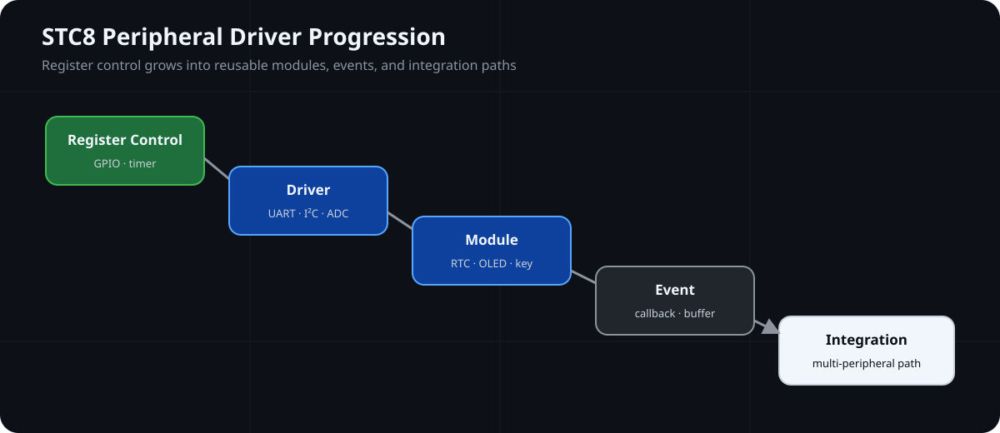

# STC8-MCU-Learning

面向 STC8H8K64U 的增强型 8051 事件驱动固件实验，包含可移植 UART RX 核心、主循环帧收集器与原创 UART1 接收适配层。

**⚙️ Peripheral Driver Progression**



## Firmware Snapshot

| Firmware Focus | Current Scope |
| --- | --- |
| Repository Type | STC8 Event-Driven Firmware Lab with Original Communication Core |
| Reference MCU | STC8H8K64U，enhanced 8051 |
| Architecture | UART1 RX ISR → STC8 Adapter → Portable Ring Buffer → Main-loop Consumer |
| Documentation | GPIO、Timer、UART、I²C、ADC、PWM、RTC、display and resource planning |
| Public Implementation | C89 ring buffer、frame collector、host-testable adapter contract, C51 ISR source and original SDCC target application |
| Verification | 48 Host tests PASS；SDCC MCS-51 compile/link/HEX and clean rebuild PASS；Keil and hardware not verified |

## 📌 Overview

仓库以文档方式整理 STC8 固件从寄存器控制、外设驱动、模块封装到事件协作的结构，并记录引脚复用、定时器占用和通信接口之间的资源约束。当前公开实现包含无动态内存的 C89 环形缓冲区、主循环帧收集器、可独立进行 Host Test 的适配器合同，以及面向 STC8H8K64U UART1 的 C51 专用接收 ISR 源码。

当前默认分支不分发课程工程、STC 厂商源码、启动文件、USB/HID 示例、RTX51 库或来源不明图片。C51 专用文件依赖外部 `STC8H.H`；另有原创最小 SDCC 寄存器声明与应用，已完成 MCS-51 目标编译、链接和 HEX 校验。板卡型号、封装、实际时钟和接线仍未确认，目标构建不能替代板端 UART 或运行验证。

## 🏗️ Architecture

```text
STC8H8K64U UART1 RX ISR
              ↓ received byte
STC8 UART Adapter Contract
              ↓ O(1) push
Portable Ring Buffer
              ↓ pop
Main-loop Consumer
```

生产者只更新 `head`，消费者只更新 `tail`；缓冲区满时不覆盖未消费数据，并置位溢出锁存标志。UART1 包装层在读取后清除错误或复位缓冲区时短暂关闭 UART1 中断，避免与 ISR 发生读后清零竞态。帧收集器只在主循环组合字节；可用显式 producer 暂停合同把适配器错误与帧收集连接起来，目标板暂停时长未验证。当前实现不包含命令解析器、TX queue 或应用逻辑。

## ✨ Key Features

| Capability | Documentation Entry |
| --- | --- |
| Portable UART RX core | [Portable UART RX Core](docs/portable-uart-core.md) |
| Main-loop frame collector | [Portable UART Frame Collector](docs/uart-frame-collector.md) |
| STC8H8K64U UART1 integration | [STC8 UART Integration](docs/stc8-uart-integration.md) |
| SDCC target build | [Reproducible SDCC target build](docs/sdcc-target-build.md) |
| Board resource planning | [Core Board and Pin Multiplexing](docs/核心板与引脚复用.md) |
| Firmware structure progression | [Engineering Structure Evolution](docs/工程结构演进.md) |
| Toolchain boundary | [Development Environment and Build](docs/开发环境与构建.md) |
| Integration planning | [Smart Terminal Design](docs/smart-terminal-design.md) |
| Evidence boundary | [Debug Notes](docs/调试记录.md) |

## 📂 Project Structure

```text
STC8-MCU-Learning/
├── .github/workflows/            # GCC/Clang host tests and SDCC target build
├── include/ring_buffer.h         # Portable public API
├── include/uart_frame.h          # Main-loop frame collection API
├── platform/stc8/                # Adapter contract, C51 and SDCC UART1 integration
├── target/sdcc/main.c            # Original minimal target application
├── scripts/build_sdcc_target.py  # Reproducible compile/link/HEX checks
├── src/core/ring_buffer.c        # C89 ring buffer implementation
├── src/core/uart_frame.c         # C89 binary frame collector
├── src/core/uart_frame_drain.c   # Quiesced queue-to-frame handoff
├── tests/                        # Ring buffer and adapter contract host tests
├── README.md
├── LICENSE
├── THIRD_PARTY_NOTICES.md
├── assets/images/architecture/  # Repository-authored SVG
└── docs/                        # Core, architecture, and integration documentation
```

## 📚 Documentation

- [Documentation Index](docs/README.md)
- [Portable UART RX Core](docs/portable-uart-core.md)
- [Portable UART Frame Collector](docs/uart-frame-collector.md)
- [STC8 UART Integration](docs/stc8-uart-integration.md)
- [Reproducible SDCC target build](docs/sdcc-target-build.md)
- [Core Board and Pin Multiplexing](docs/核心板与引脚复用.md)
- [Engineering Structure Evolution](docs/工程结构演进.md)
- [Development Environment and Build](docs/开发环境与构建.md)
- [Debug Notes](docs/调试记录.md)
- [Smart Terminal Design](docs/smart-terminal-design.md)

## 🧪 Verification

| Verification Layer | Status | Boundary |
| --- | --- | --- |
| Portable Core Host Build | PASS | GCC 16.1.0 with `-std=c89 -Wall -Wextra -Werror -pedantic` |
| Ring Buffer Host Test | PASS | 26 behavior and boundary tests |
| UART Frame Collector Host Test | PASS | 10 framing, recovery and adapter integration tests |
| Adapter Contract Host Test | PASS | 12 lifecycle, forwarding, overflow and recovery tests |
| Host CI | AUTOMATED | GitHub Actions compiles and runs ring buffer、frame collector 与 adapter 三组测试（GCC/Clang）；the C51-specific ISR file is excluded |
| STC8 / SDCC Target Build | PASS locally | SDCC 4.6.4 MCS-51 编译、链接、HEX 校验及两次全新构建哈希一致；详见构建文档 |
| STC8 / Keil Target Build | NOT PROVIDED | 本机 Keil 使用授权与支持文件来源未证实，未调用 |
| Hardware Validation | NOT PROVIDED | No reviewable STC8 board test record |
| Runtime Evidence | NOT PROVIDED | No serial log, baud measurement or logic-analyzer record |

## License Boundary

根目录 MIT License 仅覆盖当前默认分支中仓库维护者编写的源码、测试、文档、配置与自绘 SVG。课程源码、STC 厂商组件、启动文件、外部图片和二进制库未包含在当前默认分支；历史提交中的旧文件仍需单独评估。详见 [THIRD_PARTY_NOTICES.md](THIRD_PARTY_NOTICES.md)。
